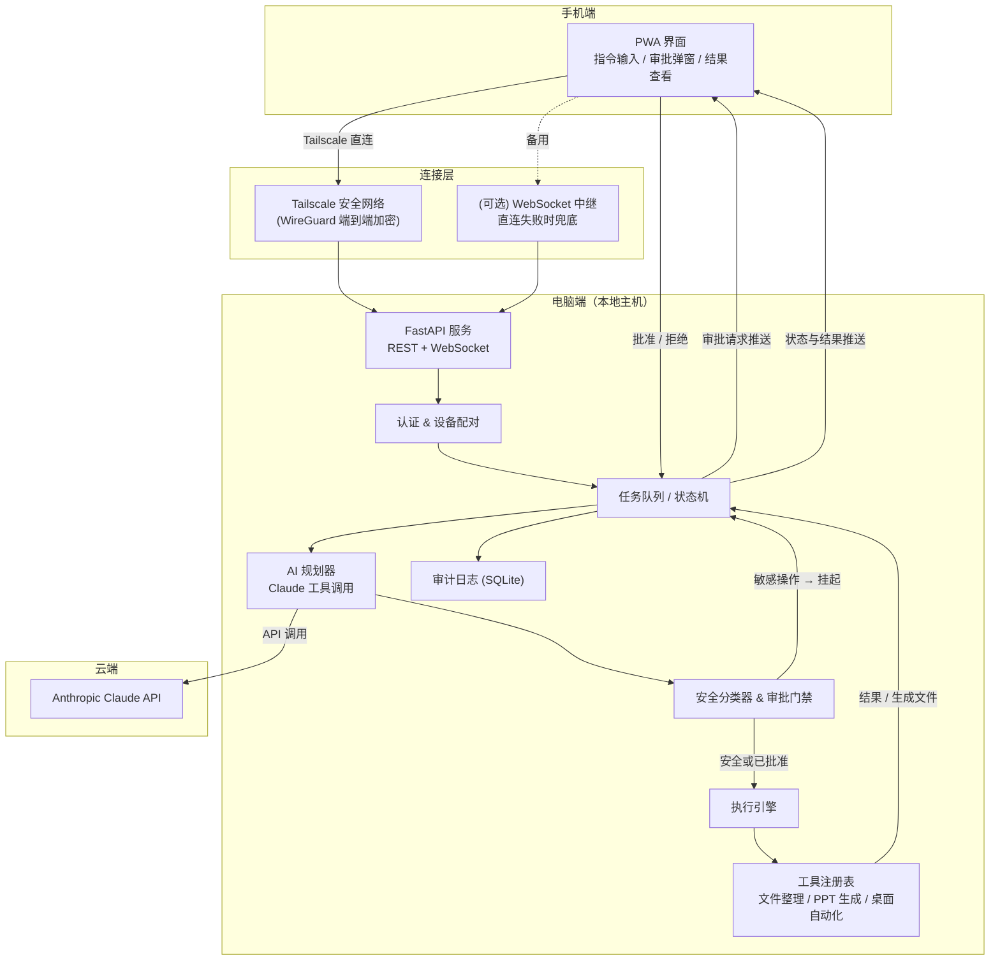
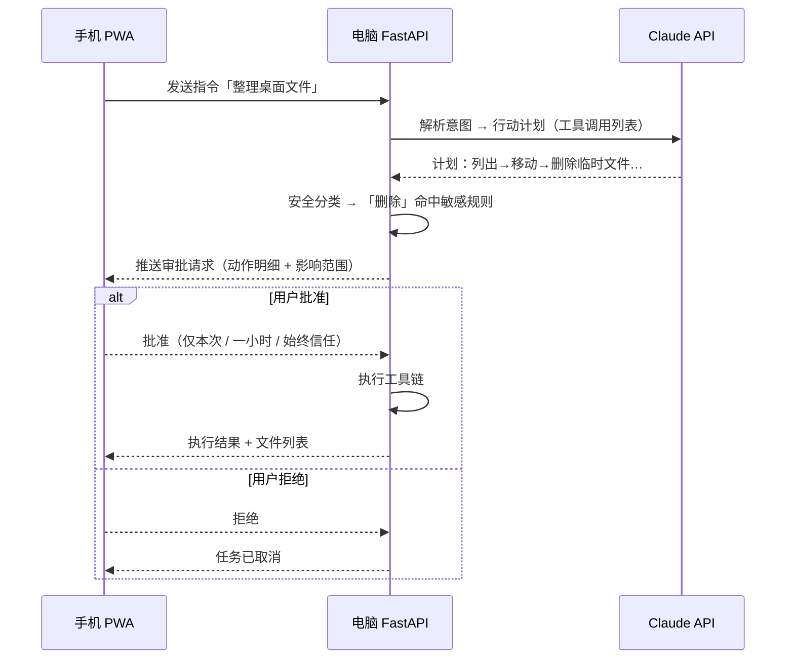

# 智能模型/工具系统 · 架构设计

> 目标：手机端远程向电脑发送自然语言指令，电脑端调用 AI 理解意图并自动执行；敏感操作需手机端确认后再执行。
> 版本：v0.1 · 2026-08-04

## 1. 核心功能

1. **远程指令执行**：手机发「帮我整理桌面文件」，电脑自动分类整理桌面文件。
2. **远程调用 AI 能力**：手机发「生成一份 Q3 产品复盘 PPT」，电脑端自动生成并保存到本地。

## 2. 整体技术架构

系统分 4 层，核心设计是「手机 = 遥控器 + 审批人，电脑 = 大脑 + 手」。

| 层 | 职责 | 关键点 |
|---|---|---|
| **接入层** | 手机与电脑的安全连接 | Tailscale 直连为主，WebSocket 中继兜底（双模式） |
| **控制层** | 手机 UI / 指令收发 / 审批 | PWA 聊天式界面 + 审批弹窗 |
| **AI 理解层** | 自然语言 → 结构化行动计划 | Claude API 工具调用（function calling） |
| **执行层** | 在电脑本地执行动作 | 工具注册表 + 执行引擎 + 审批门禁 |

**核心数据流**：
手机发指令 → 电脑解析为「行动计划（一系列工具调用）」→ 安全分类器判定是否敏感 → **敏感则挂起并推送审批到手机** → 手机确认后电脑执行 → 结果/文件列表推回手机。

### 2.1 连接方案

**主通道：Tailscale 直连**
- PC 与手机加入同一 tailnet（免费账号），WireGuard 端到端加密，自动 NAT 穿透，无需公网端口。
- 手机浏览器/PWA 直接访问 `http://100.x.x.x:8000`（PC 的 tailnet 地址）。
- 进阶：用 `tailscale cert` 给电脑申请受信证书，可上 HTTPS。

**兜底通道：WebSocket + 中继服务器**（可选里程碑）
- 手机或电脑连不上 Tailscale 时，两端都主动连到一台公网中继（小 VPS），中继只做消息转发、不落地业务。
- 客户端思路与 RustDesk 一致：**先试直连，失败自动切中继**。两者抽象成同一个「传输接口」，上层协议不变。

> MVP 阶段只做 Tailscale 直连即可跑通全流程，中继放最后再加。

### 2.2 审批机制

- 每个工具声明自己的危险级别：`safe` / `sensitive` / `dangerous`（如删除、清空回收站、格式化、改系统盘）。
- 安全分类器 = 工具级别标记 + 规则黑名单（危险命令、路径、参数）+ LLM 判断，任一命中即进入 `awaiting_approval` 状态。
- 审批请求带**动作明细与影响**（将删除哪些文件、将修改什么），手机端确认/拒绝，可带「仅本次 / 一小时 / 始终信任」。
- 超时（默认 10 分钟）自动拒绝；所有审批与执行写入**审计日志**。

## 3. 技术栈推荐

| 层 | 推荐 | 备选 | 理由 |
|---|---|---|---|
| 后端 | **Python FastAPI + uvicorn** | Node.js | 原生异步 WebSocket、Pydantic 做协议校验、与 AI SDK/执行层同语言 |
| AI 理解层 | **Claude API**（anthropic SDK）<br>模型：claude-sonnet-4-6（默认）/ claude-opus-4-6（复杂规划） | 本地模型（Ollama，离线场景） | 工具调用输出结构化、稳定 |
| 手机端 | **PWA**（React/Vue + Vite） | Flutter | 免安装、由 FastAPI 直接托管静态文件，Tailscale 内网即开即用；协议与 UI 解耦，未来可换 Flutter 客户端 |
| 连接层 | **Tailscale**（WireGuard） | 自建中继兜底 | 免费、端到端加密、无需公网 |
| 桌面自动化 | **pyautogui + keyboard + Pillow** | — | 模拟鼠标键盘、截图 |
| PPT 生成 | **python-pptx** | — | 本地直接生成 .pptx |
| 持久化 | **SQLite**（任务历史/审计） | — | 零运维，够用 |
| Windows 自启 | **NSSM** 或 **WinSW** | — | 注册为系统服务 |
| 中继（可选） | Python 或 Node.js 均可 | — | 与主后端复用同一协议 schema |

> **为什么 PWA 而非 Flutter**：审批推送是核心交互，PWA 通过常驻 WebSocket 能实时收到审批请求；免去应用商店、跨平台编译成本。代价是页面关闭时收不到推送——配合 Tailscale App 常驻 + 打开页签即可，MVP 足够。

## 4. 系统架构图

### 4.1 分层架构



### 4.2 审批流程时序



## 5. 完整开发步骤清单

**里程碑 0 · 基础设施**
1. 初始化 monorepo 项目结构（`server/` `mobile/` `relay/` `shared/`），git init
2. PC 装 Python 3.11+ venv、Node.js（PWA 构建用）
3. PC 与手机安装 Tailscale，加入同一 tailnet，记录 PC 的 `100.x.x.x`，两端 ping 通

**里程碑 1 · 通信链路**
4. FastAPI 骨架：`/health`、CORS、uvicorn 启动
5. WebSocket 端点 + 心跳（30s）+ 断线重连
6. 配对认证：首次生成配对码，手机输码换长期 token（参考 Home Assistant 模式）
7. PWA 骨架：连接配置页（电脑地址 + token）、连接状态、自动重连
8. 端到端验证：手机发 echo，电脑回复

**里程碑 2 · 指令闭环（规则先行）**
9. 任务状态机 + 队列：`created → parsing → awaiting_approval → approved → executing → done/failed/cancelled`，SQLite 持久化
10. 抽象 `Tool` 基类（名称、参数 schema、危险级别、`run()`）
11. 实现第一个工具 `organize_desktop`（按扩展名/日期归类文件）
12. 规则解析：关键词「整理桌面」→ 该工具，跑通全链路
13. **审批机制**：危险级别 + 黑名单分类 → 审批推送 → 手机确认 → 审计日志 + 超时拒绝

**里程碑 3 · AI 接入**
14. 接入 Claude API，planner 用工具调用把自然语言解析为行动计划，参数校验
15. 工具注册表：新工具自动生成 function definitions，动态注册
16. 复杂工具：PPT 生成（python-pptx）、文件搜索/汇总报告
17. 结果回传：生成文件列表 + 本地路径，手机可查看

**里程碑 4 · 健壮性与安全**
18. 任务恢复（服务重启后 pending 任务续跑）、并发上限、取消功能
19. 危险操作白/黑名单、敏感动作二次确认、token 轮换
20. pytest 覆盖状态机 / 审批 / 工具

**里程碑 5 · 部署与可选增强**
21. NSSM/WinSW 注册 Windows 开机自启服务，日志轮转
22. （可选）中继服务器 + 双模式客户端（直连失败自动切换）
23. 使用文档 + 端到端演示

## 6. 可参考的开源项目

| 项目 | 参考它的哪部分 |
|---|---|
| [Open Interpreter](https://github.com/KillianLucas/open-interpreter) | **自然语言→本机执行** 的完整管线，以及执行前「确认提示」审批交互——正是核心场景 |
| [LangGraph](https://github.com/langchain-ai/langgraph) | **任务状态机**（StateGraph）与 **interrupt 机制**：实现「审批暂停-恢复」的业界标准做法 |
| [Composio](https://github.com/ComposioHQ/composio) | **工具注册表**：action 定义、参数 schema、权限标记，工具与执行器解耦——可直接照抄其抽象层 |
| [Home Assistant](https://github.com/home-assistant) | **自托管服务 + 手机 App 远程控制**：设备配对/长期 token、WebSocket 事件推送架构 |
| [RustDesk](https://github.com/rustdesk/rustdesk) | **点对点直连 + 中继兜底**的双模式连接设计，对应「Tailscale 或 WebSocket 中继」需求，以及会话加密鉴权 |

## 7. 代码结构（可扩展性）

```
project/
├── shared/            # 跨端协议 schema（pydantic/JSON），手机与电脑共用
├── server/            # 电脑端控制中心 (FastAPI)
│   ├── app/
│   │   ├── main.py          # 入口
│   │   ├── config.py
│   │   ├── api/             # routes.py (REST) + ws.py (WebSocket)
│   │   ├── core/            # auth.py / queue.py(状态机) / events.py(推送)
│   │   ├── agents/
│   │   │   ├── planner.py   # LLM 意图→计划
│   │   │   ├── executor.py  # 执行引擎
│   │   │   └── tools/       # base.py + filesystem.py + ppt.py + …
│   │   └── safety/          # classifier.py + approval.py
│   ├── static/              # PWA 构建产物（由 mobile/ 生成）
│   └── tests/
├── mobile/            # PWA 源码（React/Vue + Vite）
├── relay/             # (可选) 中继服务器
└── docs/
```

**扩展新功能的方式**：只新增 `server/app/agents/tools/xxx.py`（继承 Tool、声明危险级别），工具注册表自动把它暴露给 Claude 规划器——不触碰其他层。
